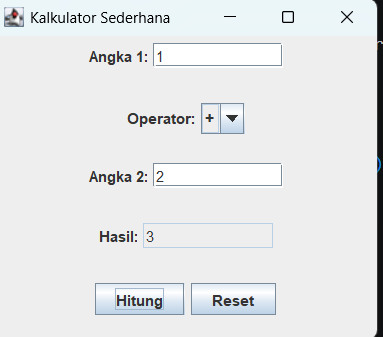

# Kalkulator Sederhana (Java Swing)

Aplikasi GUI untuk menghitung dua angka dengan operator tambah, kurang, kali, dan bagi.

**NIM:** (F1D02410103)
**Nama:** (Andre Astamam)

## Cara Menjalankan

```
javac KalkulatorSederhana.java
java KalkulatorSederhana
```

## Screenshot



## Penjelasan Komponen

### 1. Top Level Container
`JFrame frame` adalah jendela utama. Semua komponen lain ditaruh di dalamnya.

### 2. Intermediate Component
`JPanel p1` sampai `p5` adalah wadah perantara. Tiap panel mewakili satu baris tampilan:

- `p1`: input angka 1
- `p2`: pilihan operator
- `p3`: input angka 2
- `p4`: hasil
- `p5`: tombol Hitung dan Reset

### 3. Atomic Component
- `JLabel`: teks keterangan
- `JTextField`: input angka 1, angka 2, dan hasil (hasil tidak bisa diedit)
- `JComboBox`: pilihan operator (+, -, x, /)
- `JButton`: tombol Hitung dan Reset

### 4. Layout Manager
- `GridLayout(5, 1)` pada frame: 5 baris, 1 kolom, satu baris untuk tiap panel.
- `FlowLayout` pada setiap panel: komponen disusun berurutan dari kiri ke kanan.

### 5. Event Handling (2 interface)

| Interface | Method | Fungsi |
|---|---|---|
| `ActionListener` | `actionPerformed()` | Menangani klik tombol Hitung dan Reset |
| `KeyListener` | `keyPressed()` | Menghitung saat menekan Enter di kolom angka 2 |

`keyTyped()` dan `keyReleased()` wajib ada karena bagian dari interface, tetapi dibiarkan kosong.

## Logika

1. Ambil angka dari dua kolom input dengan `Double.parseDouble()`.
2. Baca operator yang dipilih dari `JComboBox`.
3. Hitung dengan `if-else` sesuai operator.
4. Tampilkan hasil di kolom hasil. Jika input bukan angka atau pembagian dengan nol, tampil pesan peringatan lewat `JOptionPane`.
